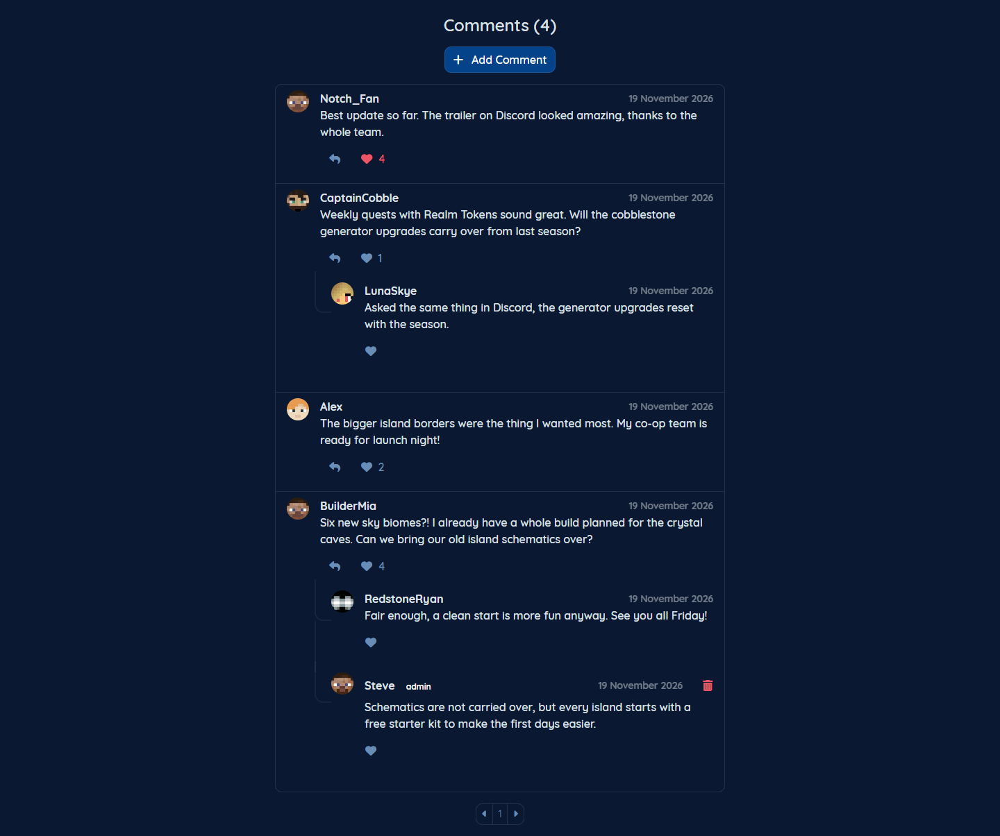
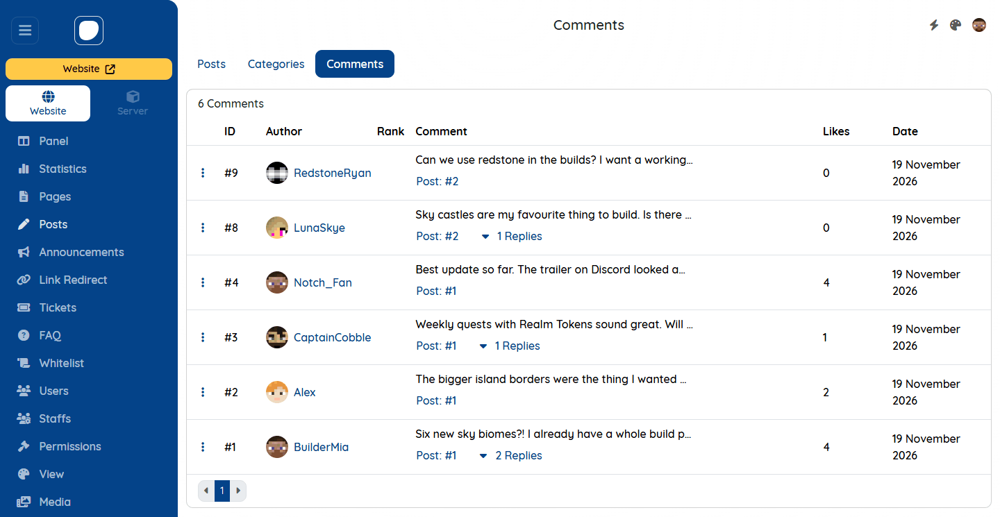

  
  <h1>Comments</h1>
  
<b>Turn your news posts into conversations with your players.</b>

  

    
    
    
  

Let your players talk about your news. Comments adds a friendly comment section under every post on your website, with replies and likes, so updates turn into real conversations. You keep full control from your panel: decide who can comment, slow down spammers and remove anything that doesn't belong.

<h3 align="center">Features</h3>

- 💬 **Comments on every post**: players share their thoughts right under your news and updates.
- ↩️ **Replies**: players answer each other and keep discussions in clean threads.
- ❤️ **Likes**: players like the comments they agree with, so the best ones stand out.
- 🔐 **Choose who can post**: let everyone comment, or only certain ranks for comments and replies.
- ⏱️ **Spam protection**: set a short wait time between comments.
- 🎨 **Your style**: show the comment form in a pop-up or right on the page, and pick page numbers or a "Load more" button.
- 🛠️ **Easy moderation**: see every comment in your panel with its author, post, likes and date, and delete in one click.

<h3 align="center">Screenshots</h3>

<i>See and manage every comment from your panel.</i>

<h3 align="center">Get started</h3>

1. Open your Pano panel and go to **Addons**.
2. Find **Comments** and click **Install**.
3. Publish a post: the comment section shows up under it on your website right away.

<h3 align="center">Support</h3>

Questions or ideas? Join our [Discord](https://panomc.com/discord) or visit [panomc.com](https://panomc.com).

<h3 align="center">License</h3>

Released under the MIT License.
